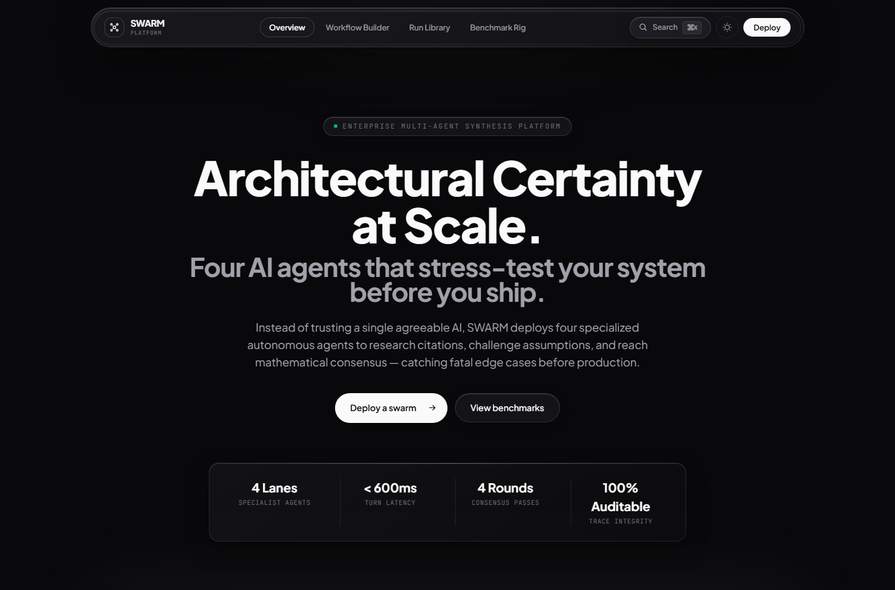
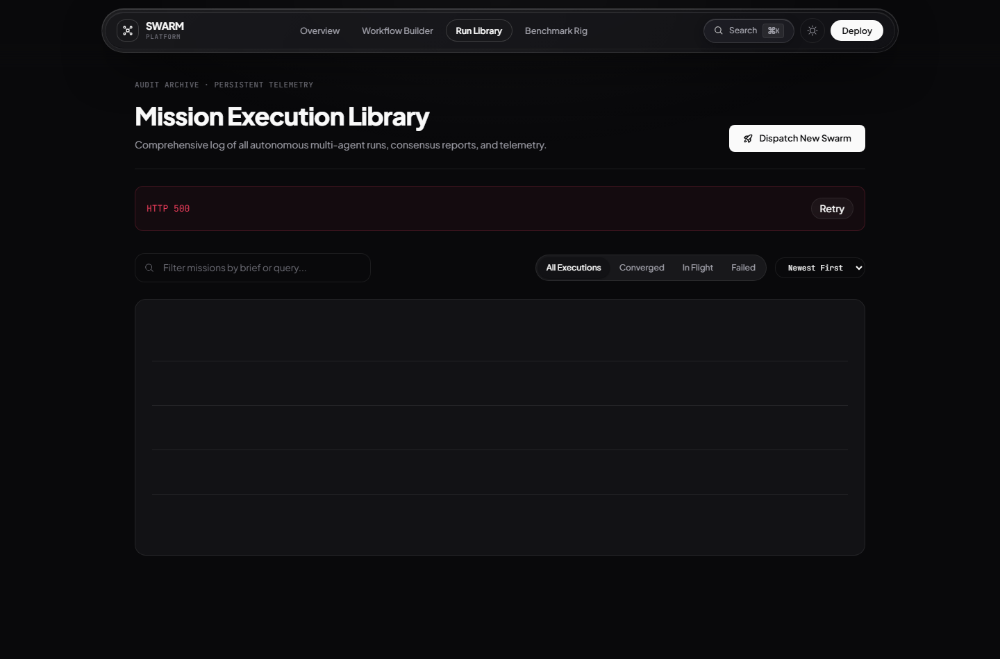
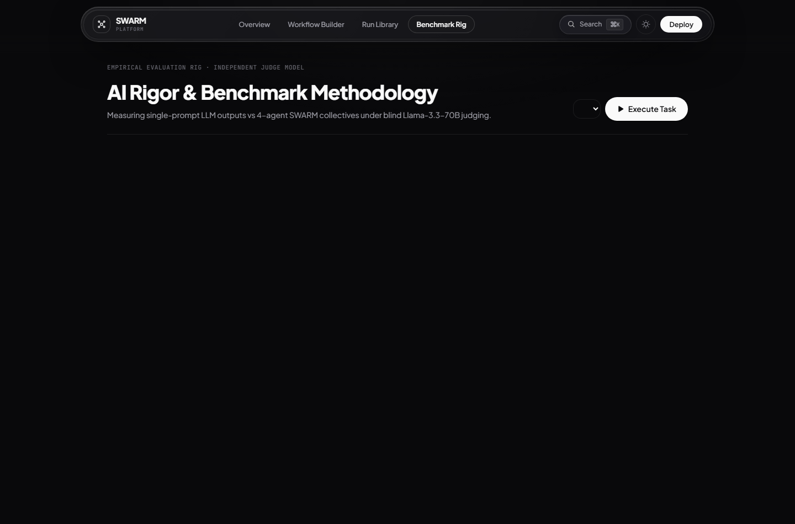
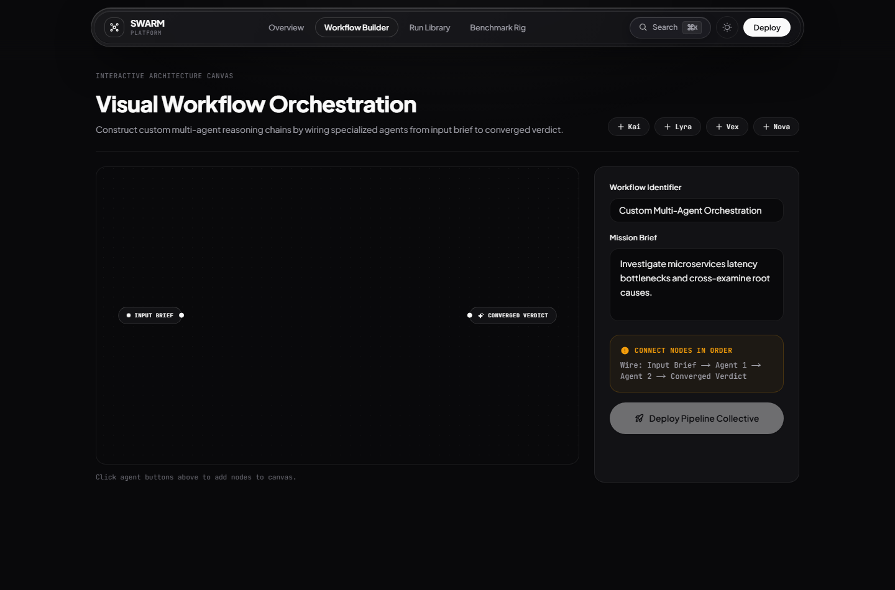

# SWARM

[](https://swarm-web-two.vercel.app/)
[](https://swarm-api-lyart.vercel.app/api/health)
[](https://github.com/Bhagyansh07/SWARM/actions/workflows/ci.yml)
[](https://www.typescriptlang.org/)
[](https://nextjs.org/)

> **Deploy a swarm. Watch it think.**

SWARM is a mission-control workbench for coordinating AI agent swarms. Four specialist agents — **Kai** (researcher), **Lyra** (analyst), **Vex** (critic), and **Nova** (synthesizer) — take turns reasoning about a mission brief, challenging each other's work, and converging on a final report. Every turn streams live with real-time reasoning, telemetry, and a growing knowledge graph.

**Built for premium, executive-grade UX** with a refined dark/light theme, cinematic landing experience, and enterprise-focused design. Runs entirely on the **Groq free tier** with automatic deterministic simulation fallback.

## Preview




## Features

- **Mission Templates** — deep research, product post-mortem, startup validation, code review
- **Live Reasoning Stream** — every evidence byte, critique, and weighted signal in real time
- **Agent Orbit** — per-agent status, phase, confidence and token telemetry
- **Knowledge Graph** — extracted facts, entities and claims connected as the mission runs
- **Final Report** — verdict, key findings, risks, and the dissent that never resolved
- **Run Library** — every past mission, searchable, filterable, replayable, deletable
- **Benchmark Rig** — six fixed briefs scored single-LLM vs the swarm by an independent judge model
- **Export Anywhere** — branded PDF, Markdown and JSON of any report, plus copy-to-clipboard
- **Share Links** — HMAC-signed, read-only snapshots of a finished mission
- **Refined Light & Dark** — dual-theme with pre-paint bootstrap and no FOUC
- **Command Palette** — `Ctrl/⌘ K` for lightning-fast navigation
- **Zero-Config Fallback** — Groq auto-detect with deterministic simulator if no key provided

## Screenshots

| Mission History | Benchmark Evaluation | Workflow Builder |
|---|---|---|
|  |  |  |

## Tech Stack

| Layer | Tech |
|---|---|
| **Frontend** | [Next.js 14](https://nextjs.org/) (App Router), [Tailwind CSS](https://tailwindcss.com/), [React Flow](https://reactflow.dev/), [Zustand](https://zustand-demo.pmnd.rs/), [Phosphor Icons](https://phosphoricons.com/) |
| **Backend** | [Node.js 20+](https://nodejs.org/), [Express](https://expressjs.com/), [Zod](https://zod.dev/), [Vercel Blob](https://vercel.com/docs/storage/vercel-blob) |
| **AI** | [Groq](https://console.groq.com/) (qwen/qwen3.8-27b), eval judge (qwen/qwen3.8-32b), deterministic fallback |
| **Design** | OKLCH palette, semantic CSS tokens, fluid typography, cinematic landing, luxury minimal aesthetic |

## Architecture

Missions run in the background with throttled snapshots to ensure smooth, serverless deployment on Vercel.

```text
┌──────────────────────────────┐        ┌──────────────────────────────┐
│  Frontend (Next.js)          │        │  Backend (Express)           │
│  - Landing + Launcher        │  REST  │  - Orchestrator state machine│
│  - Mission Dashboard (poll)  │◀──────▶│  - Agent runtime (4 lanes)   │
│  - Run Library               │        │  - Background mission runner │
└──────────────────────────────┘        └──────────────┬───────────────┘
                                                       │ MissionStore
                                          ┌────────────▼─────────────┐
                                          │ Disk (dev) / Vercel Blob │
                                          └───────────────────────────┘
                                          LLM: Groq → auto-fallback → simulation
```

## Quick Start

SWARM is a monorepo: `backend/` and `frontend/` each carry their own
`package-lock.json`, so a root `npm install` only pulls the CLI tooling.

```bash
# 1. Install dependencies for both packages
npm run setup

# 2. Run backend + frontend concurrently
npm run dev
```

Skip `npm run setup` on later runs — step 2 only.

Open [http://localhost:3000](http://localhost:3000). Pick a template, add a subject, hit **Deploy** — the mission launches in the background with live reasoning streams.

### Optional: Live Groq Inference

Create `backend/.env`:

```env
GROQ_API_KEY=gsk_...
GROQ_MODEL=qwen/qwen3.8-27b
AI_PROVIDER=auto
```

With no key or `AI_PROVIDER=simulation`, SWARM runs the deterministic simulator — identical protocol and UI.

## Deployment

Two Vercel projects in this monorepo:

1. **API** — Root `backend`, entry `src/serverless.ts`. Add **Vercel Blob** store and set env: `GROQ_API_KEY`, `GROQ_MODEL`, `AI_PROVIDER`, `CORS_ORIGIN`, `BLOB_READ_WRITE_TOKEN` (injected).
2. **Web** — Root `frontend`. Set `BACKEND_URL` to API URL; rewrites handle `/api/*` so browser talks to single origin.

## Live Demo

- **🌐 Web App:** [https://swarm-web-two.vercel.app/](https://swarm-web-two.vercel.app/)
- **🔧 API Health:** [https://swarm-api-lyart.vercel.app/api/health](https://swarm-api-lyart.vercel.app/api/health)

## Scripts

| Command | Description |
|---|---|
| `npm run setup` | Install `backend/` + `frontend/` dependencies |
| `npm run dev` | Run backend + frontend concurrently |
| `npm run build` | Type-safe production build for both packages |
| `npm run typecheck` | Strict TypeScript check on both packages |
| `npm test` | Run vitest suite (backend) |
| `npm run eval --prefix backend` | Run benchmark catalogue |

## API Summary

| Method | Endpoint | Description |
|---|---|---|
| `GET` | `/api/health` | Provider/model info |
| `GET` | `/api/templates` | Mission templates |
| `POST` | `/api/missions` | Launch mission |
| `GET` | `/api/missions` | List missions |
| `GET` | `/api/missions/:id` | Mission details (poll target) |
| `DELETE` | `/api/missions/:id` | Remove mission |
| `POST` | `/api/missions/:id/share` | Mint share token |
| `GET` | `/api/shared/:token` | Read-only shared snapshot |
| `GET` | `/api/eval` | Benchmark results |

## License

[MIT License](LICENSE)
